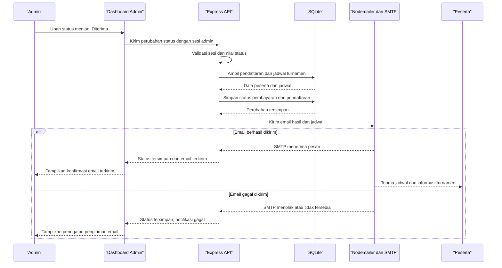

# Core Business Workflows

Badminton Hub menyediakan pemesanan lapangan dan alat, serta pendaftaran turnamen untuk peserta. Admin mengelola operasional, meninjau pesanan dan peserta, dan mengirim pemberitahuan status melalui email.

## Ringkasan Fitur Admin

Dashboard admin dibuka melalui login tersembunyi pada logo header (lima klik dalam 2,5 detik). Sesi admin berlaku delapan jam dan disimpan di memori server; restart server mengakhiri sesi. Password admin diverifikasi terhadap hash scrypt yang disimpan pada `.env.local`. Lima percobaan login gagal dari alamat IP yang sama dibatasi selama 15 menit.

| Bagian dashboard | Kemampuan yang tersedia | Penyimpanan saat ini |
|---|---|---|
| Verifikasi booking dan QRIS | Melihat pesanan, kontak, rincian, total, status; menyetujui pembayaran, menolak pesanan dengan alasan, membatalkan, menjadwalkan ulang, dan membuat pesanan walk-in/manual. Status, catatan, rincian, dan slot pesanan tersimpan di backend. | SQLite untuk pesanan yang dibuat melalui formulir publik atau admin manual. Bukti pembayaran booking lapangan hanya direpresentasikan oleh nama/penanda file; byte file bukti booking belum disimpan sebagai berkas/BLOB oleh backend. |
| Pemantauan jadwal | Melihat okupansi per tanggal, lapangan, dan jam; memindahkan booking, membatalkan slot, atau memulai booking manual dari jadwal. | Booking dibaca dari SQLite saat admin masuk. Daftar slot dan jadwal yang tampil disusun dalam state browser. |
| Lapangan dan jam | Menambah, mengubah, menghapus, mengunci/membuka lapangan, mengubah tarif, serta mengelola slot jam operasional. | Saat ini hanya mengubah `AppState` pada browser. Belum ada API/database untuk menyimpan perubahan ini secara persisten; perubahan dapat hilang setelah halaman dimuat ulang. |
| Sewa alat dan produk kafe | Menambah, mengubah, menghapus produk, mengubah harga, deskripsi, satuan, dan gambar katalog. | Saat ini hanya mengubah `AppState` pada browser dan tidak disimpan di SQLite. |
| Fasilitas arena | Menambah dan mengubah fasilitas, deskripsi, dan ikon yang ditampilkan pada halaman peserta. | Saat ini hanya state browser, bukan data backend persisten. |
| Kelola turnamen | Membuat, mengubah, menonaktifkan, atau menghapus turnamen; mengatur poster, deskripsi, jadwal, lokasi, biaya/minimal pembayaran, diskon, syarat, kategori, field tambahan, informasi admin, dan buka/tutup pendaftaran. | Disimpan di SQLite. Penghapusan ditolak jika turnamen sudah memiliki pendaftar; admin dapat menonaktifkan turnamen sebagai gantinya. |
| Data pendaftar turnamen | Melihat dan mencari peserta; memfilter berdasarkan turnamen, kategori, atau status; membuka detail dan bukti pembayaran; memperbarui status pembayaran dan status pendaftaran. | Disimpan di SQLite. Perubahan ke status pendaftaran `Diterima` atau `Ditolak` memicu email pemberitahuan. |
| Ringkasan dashboard | Menampilkan angka pendapatan, okupansi, pesanan menunggu, serta status arena. | Sebagian angka di markup dashboard merupakan angka contoh/statis, bukan laporan finansial atau okupansi yang dihitung dari seluruh data database. |

Perubahan status booking dari dashboard mengirim email untuk konfirmasi (`LUNAS`/`Disetujui`), penolakan, atau pembatalan. Perubahan status turnamen mengirim email ketika pendaftaran berubah menjadi diterima atau ditolak. Pesan disusun dari jadwal dan catatan yang tersimpan saat perubahan dilakukan. Jika pengiriman email gagal, status yang telah tersimpan tidak dibatalkan; admin mendapat pemberitahuan kegagalan.

## Teknologi dan Batas Arsitektur

- **Frontend:** HTML, CSS/Tailwind, dan JavaScript browser klasik. `AppState` menjadi state untuk jadwal, lapangan, produk, fasilitas, keranjang, dan sebagian tampilan admin.
- **Tooling/server lokal:** Vite menjalankan halaman dan memasang middleware API melalui plugin proyek. Middleware autentikasi dan API menggunakan Express. Perintah pengembangan menjalankan Node pada port `3000` dan menerima koneksi jaringan lokal.
- **Runtime backend:** Node.js 22 atau lebih baru. SQLite diakses dengan modul bawaan `node:sqlite` (`DatabaseSync`); file database utama adalah `server/data/tournaments.sqlite`.
- **Email:** Nodemailer mengirim verifikasi akun, reset password, dan notifikasi status menggunakan SMTP yang dikonfigurasi lewat `.env.local` (misalnya Gmail SMTP dan Google App Password). Kredensial SMTP tidak dikirim ke browser.
- **Autentikasi:** Password di-hash dengan scrypt dari `node:crypto`; token verifikasi/reset disimpan dalam bentuk hash dan memiliki masa berlaku. Cookie sesi admin dan peserta memakai `HttpOnly` dan `SameSite=Strict`. Sesi admin berada dalam memori proses, sedangkan sesi peserta disimpan sebagai hash token dan waktu kedaluwarsa di SQLite.
- **Batas deployment:** Menyajikan folder `dist` sebagai situs statis saja tidak menjalankan API. Deployment yang mendukung alur akun, admin, dan database harus menjalankan backend Node/middleware serta menyediakan file SQLite persisten. Produksi wajib menggunakan HTTPS dan `APP_PUBLIC_URL` publik yang benar.
- **Bukan layanan terpisah:** Saat ini tidak ada arsitektur microservice. UI browser, API admin/peserta, database SQLite, dan pengirim email membentuk satu aplikasi; API domain berbagi database yang sama.

## Domain Entities

| Entity | Service / Bounded Context | Makna bisnis | Hubungan utama |
|---|---|---|---|
| Turnamen | Pengelolaan Turnamen | Acara badminton yang dipublikasikan dan menerima pendaftaran pada periode tertentu. | Memiliki banyak pendaftaran; menjadi sumber detail jadwal, lokasi, kategori, biaya, dan ketentuan. |
| Pendaftaran Turnamen | Pendaftaran Peserta | Permintaan peserta untuk mengikuti kategori tertentu dalam satu turnamen. | Terhubung ke satu turnamen dan satu akun peserta; membawa status pendaftaran dan pembayaran, data pasangan/tim, dan bukti pembayaran bila tersedia. |
| Akun Peserta | Akun dan Identitas | Identitas peserta untuk login, verifikasi email, pendaftaran turnamen, dan melihat riwayat. | Dapat memiliki beberapa pendaftaran turnamen dan pesanan lapangan. |
| Sesi Peserta | Akun dan Identitas | Akses login peserta yang berlaku sampai kedaluwarsa atau dihapus. | Dimiliki satu akun peserta. |
| Pesanan Lapangan | Pemesanan Arena | Permintaan pemesanan slot dan/atau tambahan produk oleh pelanggan atau admin. | Menyimpan slot, tambahan, total, status, catatan admin, kontak pelanggan, dan secara opsional akun peserta. |
| Lapangan dan Slot Jam | Operasional Arena | Sumber daya fisik dan pilihan waktu yang ditawarkan untuk bermain. | Slot pesanan menunjuk lapangan dan waktu yang diminta; katalog aktual saat ini berada di state browser. |
| Produk/Fasilitas Arena | Katalog dan Informasi Arena | Informasi barang sewa/kafe dan fasilitas yang ditampilkan di halaman peserta. | Dapat menjadi tambahan dalam pesanan; data katalog/fasilitas saat ini berada di state browser, bukan tabel database. |

## Service-to-Domain Mapping

| Service / komponen | Konteks domain | Data yang dimiliki | Dependensi |
|---|---|---|---|
| UI peserta dan admin | Presentasi dan interaksi pengguna | State sesi halaman, tampilan filter, keranjang, dan data konfigurasi demo yang belum dipersistenkan. | REST API di server aplikasi. |
| Middleware Express admin | Otorisasi admin dan operasional | Sesi admin dalam memori; memeriksa akses ke panel dan endpoint admin. | `.env.local`, API turnamen/pesanan, SQLite, pengirim email. |
| API akun peserta | Identitas dan riwayat peserta | Pendaftaran akun, verifikasi/reset, sesi peserta, riwayat, dan pesanan peserta/tamu. | SQLite dan SMTP melalui Nodemailer. |
| API turnamen | Pengelolaan turnamen dan pendaftaran | Turnamen, pendaftaran, status peserta/pembayaran, poster, dan bukti pembayaran turnamen. | SQLite; pengirim email untuk perubahan status pendaftaran. |
| SQLite | Persistensi bersama | Tabel turnamen, pendaftaran turnamen, akun/sesi peserta, dan pesanan lapangan. | File `server/data/tournaments.sqlite`; dibuka oleh API dalam proses Node. |
| Nodemailer/SMTP | Notifikasi | Tidak memiliki data domain sebagai sumber kebenaran; hanya mengirim pesan kepada email peserta/pelanggan. | Kredensial SMTP server dan alamat penerima dari record tersimpan. |

Tidak ada pertukaran antar-microservice. API akun, turnamen, dan booking berkomunikasi langsung melalui proses Node dan tabel SQLite bersama. Browser mengambil/menulis data persisten melalui HTTP JSON; katalog lapangan/produk/fasilitas yang belum dipersistenkan tidak ikut alur database tersebut.

## Primary Workflows

### Workflow 1: Admin menyiapkan dan menerbitkan turnamen

1. Admin login melalui modal dashboard. Server memeriksa username dan hash password dari konfigurasi serta menerbitkan cookie sesi jika kredensial benar.
2. Admin membuka **Kelola Turnamen**, mengisi informasi turnamen dan mengunggah poster.
3. UI mengirim perubahan ke API admin. API memastikan sesi admin valid, memvalidasi nilai, menyimpan data turnamen dan poster ke SQLite, lalu mengembalikan hasil.
4. Halaman peserta membaca daftar turnamen aktif dari API publik. Turnamen yang dinonaktifkan atau pendaftarannya ditutup tidak dapat menerima pendaftaran baru.

### Workflow 2: Peserta mendaftar dan admin memutuskan penerimaan

1. Peserta mendaftar akun dengan nama, WhatsApp, email, dan password. Backend menyimpan akun belum terverifikasi, membuat token verifikasi sekali pakai dengan masa berlaku, lalu mengirim tautan melalui SMTP.
2. Peserta membuka tautan. UI mengirim token ke API verifikasi; jika token valid dan belum kedaluwarsa, akun ditandai terverifikasi dan peserta dapat login.
3. Peserta memilih turnamen dan kategori. Backend mewajibkan sesi peserta aktif, memeriksa bahwa turnamen aktif, pendaftaran dibuka, tenggat belum lewat, dan data pendaftar sesuai kategori/field tambahan.
4. Backend menyimpan pendaftaran, kode pendaftaran, pilihan pasangan/tim, data tambahan, pembayaran, dan bukti pembayaran turnamen bila disediakan. Pendaftaran awal berstatus `Menunggu Konfirmasi`; pembayaran berstatus sesuai kondisi bukti/biaya.
5. Admin melihat daftar pendaftar, mencari atau memfilter data, memeriksa detail dan bukti pembayaran, lalu memperbarui status pembayaran serta pendaftaran.
6. Perubahan status pendaftaran menjadi `Diterima` atau `Ditolak` disimpan terlebih dahulu. Setelah itu backend mengirim email yang memuat hasil, jadwal turnamen, lokasi, kategori, kode pendaftaran, dan status pembayaran. Jika email gagal, perubahan status tetap berlaku dan dashboard memberi tahu admin.
7. Peserta dapat melihat status serta riwayat melalui akunnya; kode pendaftaran juga dapat digunakan untuk memeriksa status publik terbatas.

### Workflow 3: Pelanggan memesan lapangan dan admin memproses pembayaran

1. Pelanggan memilih satu atau lebih slot lapangan dan produk tambahan pada UI, lalu mengirim data pemesanan, kontak, total, dan penanda nama bukti pembayaran.
2. Backend memvalidasi format data, batas jumlah slot/produk, total harga, slot duplikat, dan benturan terhadap booking yang masih aktif. Jika lolos, backend membuat ID booking dan menyimpan pesanan berstatus `Menunggu Verifikasi` di SQLite.
3. Jika pelanggan sedang login, booking ditautkan ke akun untuk riwayat. Booking tamu tetap tersimpan dan memiliki ID, tetapi tidak muncul pada riwayat akun peserta.
4. Admin memuat daftar booking persisten, memeriksa informasi yang tersedia dan mengubah status. Status `LUNAS`/`Disetujui`, `DITOLAK`, atau `DIBATALKAN` beserta catatan dan slot baru disimpan di backend.
5. Saat status memasuki kondisi konfirmasi, penolakan, atau pembatalan yang baru, backend mengirim email rincian pesanan. Kegagalan email tidak membatalkan perubahan status. Admin juga dapat membuat pesanan manual; data booking manual disimpan, tetapi katalog dan konfigurasi jadwal dasarnya masih dikelola pada state browser.

### Workflow 4: Admin mengubah konfigurasi operasional non-turnamen

Admin dapat mengedit lapangan dan tarif, jam operasional, produk, serta fasilitas lewat panel. Implementasi saat ini memperbarui objek `AppState` di browser tanpa endpoint backend atau tabel SQLite untuk data tersebut. Akibatnya perubahan ini tidak menjadi konfigurasi server bersama dan dapat hilang saat halaman dimuat ulang; hal ini berbeda dari turnamen dan pesanan yang memang persisten.

## Cross-Service Data Flows

Semua aliran data berjalan di satu aplikasi:

- **UI peserta → API akun → SQLite:** akun, verifikasi, sesi, pesanan terhubung akun, serta riwayat peserta.
- **UI peserta → API turnamen → SQLite:** daftar turnamen aktif dan pengiriman pendaftaran terautentikasi. Poster disajikan sebagai respons gambar; pendaftaran beserta bukti bayar turnamen disimpan pada record terkait.
- **UI admin → middleware admin → API domain → SQLite:** cookie admin diperiksa sebelum daftar/detail/perubahan turnamen, pendaftar, dan booking dikembalikan atau disimpan.
- **API domain → Nodemailer → SMTP → email penerima:** API membentuk pesan dari status dan jadwal terkini setelah penyimpanan status. SMTP bukan sumber kebenaran status.
- **Admin konfigurasi lapangan/produk/fasilitas → `AppState` browser:** tidak ada aliran menuju database saat ini. Ini membatasi konsistensi antara browser berbeda dan persistensi setelah reload.

Kegagalan validasi atau konflik slot menghentikan penyimpanan pesanan/pendaftaran dan API mengembalikan error. Jika pengiriman email status gagal setelah perubahan database, data tidak dikembalikan ke status lama: hasil bisnis tetap tersimpan, tetapi notifikasi eksternal tidak terkirim.

## Business Workflow Sequence

<!-- mermaid-checked: every participant uses `participant Id as "Label"`, no \n in aliases/messages/notes, every alt/opt/loop closed by end, no `:` inside any alias -->

## Business Rules & Decision Logic

### Akun dan otorisasi

- Pendaftaran turnamen memerlukan akun peserta yang sudah memverifikasi email dan sesi aktif.
- Password peserta minimal 12 karakter dan di-hash dengan scrypt; sesi peserta menggunakan token acak, sementara hash token disimpan di SQLite.
- Token verifikasi berlaku 30 menit. Token reset password berlaku 15 menit, hanya dapat dipakai sekali, dan reset mengakhiri sesi peserta yang sudah aktif.
- Endpoint pengelolaan admin memerlukan sesi admin. Cookie admin `HttpOnly` dan `SameSite=Strict`; lima percobaan login gagal dibatasi selama 15 menit.

### Turnamen dan pendaftaran

- Turnamen harus aktif, pendaftaran terbuka, dan tenggat belum lewat untuk menerima peserta.
- Data nama, WhatsApp, email, kategori, jumlah pasangan/tim, field tambahan, nilai pembayaran, serta tipe/ukuran gambar divalidasi oleh API.
- Poster dan bukti pembayaran pendaftaran turnamen menerima tipe gambar yang didukung dan memiliki batas ukuran 5 MB.
- Nilai awal pendaftaran adalah `Menunggu Konfirmasi`; pembayaran bisa `Menunggu Pembayaran`, `Menunggu Verifikasi`, atau `Tidak Diperlukan` berdasarkan konfigurasi dan bukti.
- Status pembayaran yang diizinkan: `Menunggu Pembayaran`, `Menunggu Verifikasi`, `Lunas`, `Ditolak`, `Tidak Diperlukan`. Status pendaftaran: `Menunggu Konfirmasi`, `Diterima`, `Ditolak`.
- Email keputusan dikirim jika status pendaftaran berubah menjadi `Diterima` atau `Ditolak`; menyetel status yang sama lagi tidak mengirim konfirmasi duplikat.
- Turnamen yang memiliki pendaftar tidak dapat dihapus; nonaktifkan agar arsip dan hubungan peserta tetap terjaga.

### Booking lapangan dan pembayaran

- Booking memerlukan nama/kontak valid, rincian slot dan produk valid, total yang sesuai dengan harga hitungan, dan tidak boleh memuat slot duplikat atau bentrok dengan pesanan aktif lain.
- Booking peserta terhubung ke akun hanya jika dibuat dalam sesi login. Booking tamu tetap dicatat dengan ID dan email kontaknya.
- Status pesanan yang didukung meliputi `Menunggu Verifikasi`, `LUNAS`, `Disetujui`, `DITOLAK`, dan `DIBATALKAN`.
- Email status booking dikirim ketika terjadi transisi baru ke status konfirmasi, penolakan, atau pembatalan. Perubahan catatan/jadwal tanpa transisi status tersebut tidak memicu email status.
- Penyimpanan status terjadi sebelum pengiriman email. Jika SMTP gagal, API mempertahankan status dan mengembalikan penanda bahwa email gagal.
- Status pembayaran booking mencerminkan keputusan admin/manual; aplikasi belum terhubung dengan payment gateway sehingga `LUNAS` bukan hasil verifikasi transaksi otomatis oleh gateway.
- Booking lapangan hanya menyimpan nama file bukti sebagai penanda saat ini; file bukti aktual belum dipersistenkan oleh API booking. Ini berbeda dengan bukti turnamen yang disimpan sebagai BLOB.

### Transaksi, integritas, dan batasan

- SQLite menjadi penyimpanan persisten tunggal untuk akun, sesi peserta, turnamen, pendaftaran, dan booking. Katalog konfigurasi browser bukan bagian dari transaksi SQLite.
- Pemeriksaan benturan booking dan penyimpanan dilakukan pada backend agar klien tidak dapat mengklaim slot yang sudah terpakai melalui UI saja.
- Penyimpanan status dan pengiriman email adalah dua operasi berbeda: database adalah sumber kebenaran, sedangkan email merupakan efek eksternal yang dapat gagal setelah perubahan tersimpan.
- Sesi admin berada di memori proses, sehingga restart server mengharuskan admin login kembali. File SQLite harus disertakan dalam prosedur backup.
- Nilai ringkasan yang masih hardcoded dan konfigurasi yang hanya ada di `AppState` tidak boleh diperlakukan sebagai laporan/database operasional yang terjamin konsisten.
